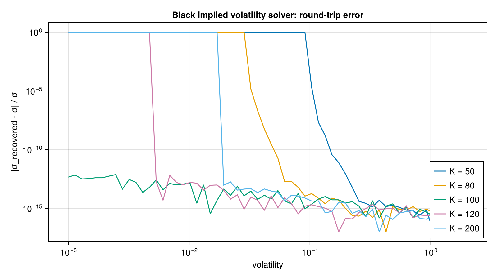

# AQFED.jl
Julia package for the book [Applied Quantitative Finance for Equity Derivatives](https://jherekhealy.github.io)

## Installation

Requires Julia 1.x. Clone the repository, then install the package from the Julia REPL:
```julia
julia> using Pkg
julia> Pkg.add(url="https://github.com/jherekhealy/AQFED.jl")
```
Or, from a local clone, start Julia in the AQFED folder, press `]` to enter the package manager and run
```julia
(AQFED) pkg> activate .
(AQFED) pkg> instantiate
```
Then `using AQFED`. The test suite runs with `(AQFED) pkg> test`.

## Available Modules

Each module has its own README with the main functions and examples.

| Module | What it provides |
| --- | --- |
| [Implied Volatility Solver](src/black) | Black-Scholes formula, greeks via automatic differentiation, and fast robust implied volatility solvers. |
| [Piecewise-Lognormal Model](src/pln) | Spot (piecewise-lognormal) model for cash dividends: fast and accurate approximations. |
| [American Option Pricing](src/american) | Andersen-Lake and Ju-Zhong techniques, including business-time and interval variants. |
| [Basket Option Pricing](src/basket) | Curran and Deelstra approximations, Vorst expansions; reusable for Asian options and vanilla options in the piecewise-lognormal model. |
| [Asian Options](src/asian) | Fixed and floating strike Asian options, Vorst expansion, Monte Carlo reference, basket and spread variants. |
| [Spread Options](src/spread) | Pearson-type spread pricer and Margrabe reference. |
| [Term Structures](src/ts) | Discount and drift curves, discrete dividend markets, Heston term structures. |
| [Volatility Models and Calibration](src/vol) | Fengler and multiquadric RBF surfaces, SVI, SSVI, SABR, Heston, lognormal mixture, variance swaps, American section calibration. |
| [Local Volatility (PDDE)](src/pdde) | One-step local volatility: Andersen-Hagan, B-spline and Green approximations, and LVG models with calibration. |
| [Collocation](src/collocation) | Fit market implied vols via stochastic collocation. |
| [Finite Differences](src/fdm) | TR-BDF2, Crank-Nicolson, Rannacher and stabilised explicit (RKL, RKG, RKC) solvers, and scripted path-dependent products. |
| [Monte Carlo](src/mc) | Brownian bridge, Heston, Heston with local volatility and CGMY simulation. |
| [Rough Volatility](src/rough) | Rough Heston and flat rough Bergomi models, hybrid simulation and roughness estimation. |
| [Bachelier](src/bachelier) | Bachelier formula and corresponding implied volatility solver. |
| [Fractals](src/fractal) | Fractal pictures of implied volatility solver convergence. |
| [Minimizers](src/minimizer) | Differential evolution and simulated annealing for calibration. |
| [Random Number Generators](src/random) | Good pseudo and quasi random number generators. |

## Example



*Round-trip test of the Black implied volatility solver: a call is priced with a known volatility, inverted, and compared with the input. Each module README has its own figure and code.*

Code that generates the figure (run from the repository root with CairoMakie installed):

```julia
using AQFED, CairoMakie
import AQFED.Black

# Round trip: price a call with a known volatility, invert the price, and compare with the input
f = 100.0; T = 1.0; df = 1.0
vols = 10 .^ range(-3, log10(2.0), length=60)
strikes = [50.0, 80.0, 100.0, 120.0, 200.0]
fig = Figure(size=(800, 450))
ax = Axis(fig[1, 1], xlabel="volatility", ylabel="|σ_recovered - σ| / σ",
    xscale=log10, yscale=log10, title="Black implied volatility solver: round-trip error")
for K in strikes
    errs = Float64[]
    for σ in vols
        p = Black.blackScholesFormula(true, K, f, σ * σ * T, df, 1.0)
        s = Black.impliedVolatility(true, p, f, K, T, 1.0)
        push!(errs, max(abs(s - σ) / σ, 1e-17))
    end
    lines!(ax, vols, errs, label="K = $(Int(K))")
end
axislegend(ax, position=:rb)
save("resources/images/black_iv_roundtrip_error.png", fig, px_per_unit=2)
```
