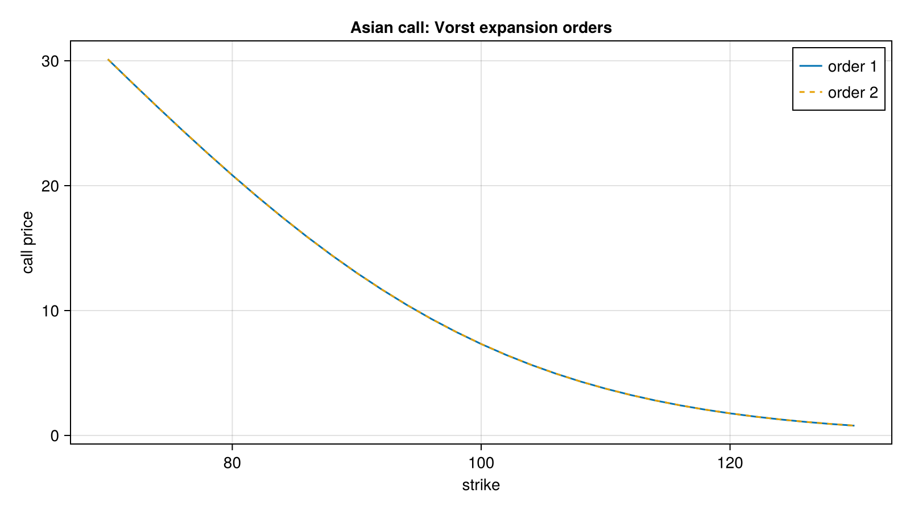

# Asian Options

Arithmetic-average Asian options, fixed and floating strike, including basket and spread variants.

## Fixed strike
- `priceAsianFixedStrike`: entry point for fixed-strike Asians. `VorstAsianExpansion` gives Vorst's closed-form approximation.
- `MonteCarloByPathEngine`: path-based Monte Carlo reference, usable for any model that can simulate the average.
- `priceAsianBasketFixedStrike` and `priceAsianSpread`: basket and spread Asian variants.

## Floating strike
- `priceAsianFloatingStrike`, including the spread variant `priceAsianFloatingStrikeWithSpread` (and its `D` version).
- `priceAsianBasketSpread`: basket spread Asian.

Some variants (`basketbridge.jl`, `strikespread.jl`) build on the [basket](../basket) pricers, such as `VorstGeometricExpansion`.

## Figure



*Fixed-strike Asian call with 12 monthly fixings, using Vorst expansions of order 1 and 2. The two orders are nearly indistinguishable over this range of strikes.*

Code that generates the figure (run from the repository root with CairoMakie installed):

```julia
using AQFED, CairoMakie
import AQFED.Asian: priceAsianFixedStrike, VorstAsianExpansion

# Fixed strike Asian call with 12 monthly fixings, Vorst expansions of increasing order
spot = 100.0; vol = 0.3; tte = 1.0; n = 12
fixingTimes = [i / n * tte for i in 1:n]
forwards = fill(spot, n)
totalVariances = vol^2 .* fixingTimes
weights = ones(n) / n
strikes = collect(70.0:2.0:130.0)
prices1 = [priceAsianFixedStrike(VorstAsianExpansion(1), true, k, 1.0, spot, forwards, totalVariances, weights) for k in strikes]
prices2 = [priceAsianFixedStrike(VorstAsianExpansion(2), true, k, 1.0, spot, forwards, totalVariances, weights) for k in strikes]

fig = Figure(size=(800, 450))
ax = Axis(fig[1, 1], xlabel="strike", ylabel="call price", title="Asian call: Vorst expansion orders")
lines!(ax, strikes, prices1, label="order 1")
lines!(ax, strikes, prices2, linestyle=:dash, label="order 2")
axislegend(ax, position=:rt)
save("resources/images/asian_vorst_orders.png", fig, px_per_unit=2)
```
