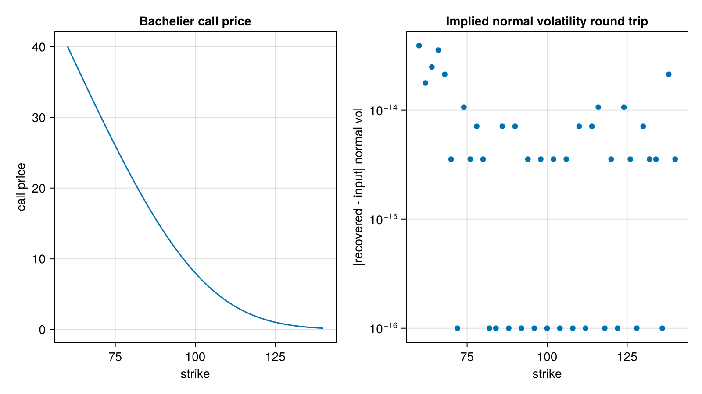

## Bachelier formula and implied volatility

- `bachelierFormula` prices a vanilla European option under the Bachelier (normal) model.
-  `bachelierImpliedVolatility` finds the Bachelier volatility for a given vanilla option price, using the fast and machine accurate rational representation of Le Floc'h.


## References

Le Floc'h, F. (2016) [Fast and Accurate Analytic Basis Point Volatility](https://papers.ssrn.com/sol3/papers.cfm?abstract_id=2420757)

## Figure



*Left: Bachelier call prices with normal volatility 20. Right: round-trip error of the implied normal volatility solver, at machine precision.*

Code that generates the figure (run from the repository root with CairoMakie installed):

```julia
using AQFED, CairoMakie
import AQFED.Bachelier: bachelierFormula, bachelierImpliedVolatility

# Bachelier (normal) model: call prices against strike, and round-trip error of the implied normal volatility solver
forward = 100.0; tte = 1.0; normalVol = 20.0
strikes = collect(60.0:2.0:140.0)
prices = [bachelierFormula(true, k, forward, normalVol, tte, 1.0) for k in strikes]
recovered = [bachelierImpliedVolatility(p, true, k, tte, forward, 1.0) for (p, k) in zip(prices, strikes)]

fig = Figure(size=(800, 450))
ax1 = Axis(fig[1, 1], xlabel="strike", ylabel="call price", title="Bachelier call price")
lines!(ax1, strikes, prices)
ax2 = Axis(fig[1, 2], xlabel="strike", ylabel="|recovered - input| normal vol", yscale=log10,
    title="Implied normal volatility round trip")
scatter!(ax2, strikes, max.(abs.(recovered .- normalVol), 1e-16))
save("resources/images/bachelier_price_iv.png", fig, px_per_unit=2)
```
