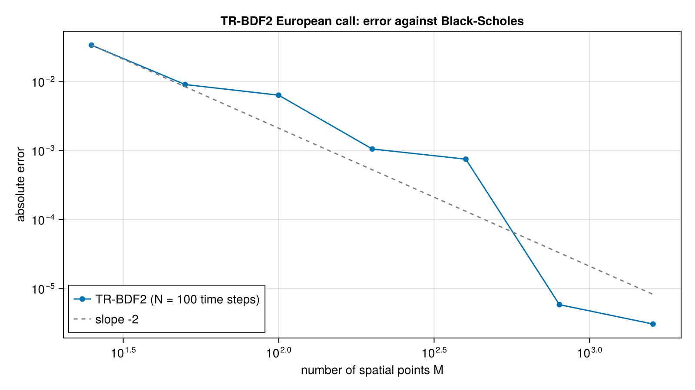

# Finite Difference Methods

Finite difference solvers for one-dimensional and multi-state option problems.

## Time stepping (`solver.jl`)
- `priceTRBDF2` solves the backward problem with time-stepping schemes `TRBDF2`, `CrankNicolson`, `BDF1` and `Rannacher` (the latter damps the first steps of Crank-Nicolson).
- Boundary conditions via `Down` and `Up`; `DividendPolicy`, `NoCalibration` and `ForwardCalibration` control dividend handling and grid calibration.

## Explicit and stabilised explicit schemes
- `priceRKL2`, `priceRKG2`, `priceRKC2`: Runge-Kutta-Legendre, Gegenbauer and Chebyshev super-time-stepping, for stiff diffusion problems with large stable steps.
- `priceExplicitEuler`: baseline explicit scheme.

## Scripted products (`payoff.jl`)
- `BackwardScript` with `ScriptEvent`s (`on`, `jump!`, `setState!`) describes path-dependent products on a `ProductStateGrid`.
- Ready-made scripts: `autocallScript`, `asianScript`, `volatilitySwapScript`, `discreteVolatilitySwapScript`.

## Other
- `heston.jl`: finite differences for the Heston model; `american_dividends.jl`: American options with discrete dividends; `grid.jl`: grid construction; `rkl.jl`: RKL coefficients.

## Figure



*Absolute error of the TR-BDF2 price against Black-Scholes as the spatial grid is refined (N = 100 time steps). The error falls roughly along the dashed slope -2 line, with some irregularity at fine grids.*

Code that generates the figure (run from the repository root with CairoMakie installed):

```julia
using AQFED, CairoMakie
import AQFED.FDM: priceTRBDF2, VanillaEuropean
import AQFED.TermStructure: CapitalizedDividend
import AQFED.Black

# Error of the TR-BDF2 finite difference price against Black-Scholes, as the spatial grid is refined
strike = 100.0; spot = 100.0; tte = 1.0; vol = 0.2; r = 0.05
forward = spot * exp(r * tte); df = exp(-r * tte)
dividends = CapitalizedDividend{Float64}[]
reference = Black.blackScholesFormula(true, strike, forward, vol^2 * tte, 1.0, df)
payoff = VanillaEuropean(true, strike, tte)
Ms = [25, 50, 100, 200, 400, 800, 1600]
errors = [abs(priceTRBDF2(payoff, spot, forward, vol^2 * tte, df, dividends, M=m, N=100)(spot) - reference) for m in Ms]

fig = Figure(size=(800, 450))
ax = Axis(fig[1, 1], xlabel="number of spatial points M", ylabel="absolute error",
    xscale=log10, yscale=log10, title="TR-BDF2 European call: error against Black-Scholes")
scatterlines!(ax, Ms, errors, label="TR-BDF2 (N = 100 time steps)")
lines!(ax, Ms, errors[1] .* (Ms ./ Ms[1]) .^ (-2.0), linestyle=:dash, color=:gray, label="slope -2")
axislegend(ax, position=:lb)
save("resources/images/fdm_trbdf2_convergence.png", fig, px_per_unit=2)
```
