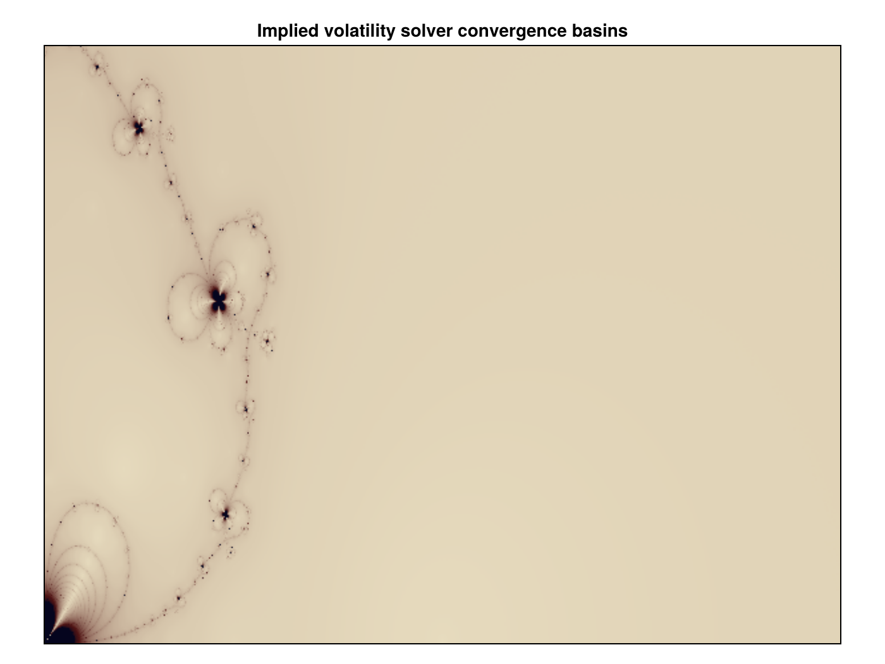

# Fractals of Implied Volatility Solvers

Fractal images of the convergence basins of root-finding methods applied to implied volatility inversion. Useful for judging the robustness of a solver: regions that do not converge to the right root show up as noise in the picture.



*Each pixel is coloured by the root the iteration converges to from that starting point. Dark, fine-grained boundaries mark starting values where the solver is sensitive to the initial guess.*

Code that generates the figure (run from the repository root with CairoMakie installed):

```julia
using AQFED, CairoMakie
import AQFED.Fractal

# Convergence basins of the Black-Scholes implied volatility solver, coloured by the root reached
img = Fractal.makeBlackFractal(600, 450, 0.0, 2.0, 0.0, 1.0)
fig = Figure(size=(700, 525))
ax = Axis(fig[1, 1], title="Implied volatility solver convergence basins", aspect=DataAspect())
hidedecorations!(ax)
image!(ax, rotr90(img))
save("resources/images/black_fractal.png", fig, px_per_unit=2)
```

## Usage
- `makeBlackFractal(w, h, xMin, xMax, yMin, yMax; ...)` renders the Black-Scholes implied volatility fractal on a grid of `w` by `h` pixels.
- `makeFractal` is the generic version, taking the function to invert as `f`.
- `curranFractal` (`curran_fractal.jl`) is an alternative renderer using the same solver and colouring options.

## Options
- `solver`: `Householder()`, `Newton()` or `FractalSRSolver(...)` (e.g. super-Halley).
- `coloring`: `PaletteColoring()`, `SpectralColoring()` or `SinColoring()`.
- `maxIter`, `accuracy`: iteration limit and stopping tolerance.

The output is a matrix of colours; plot it with any image library (the book's figures use Makie).
