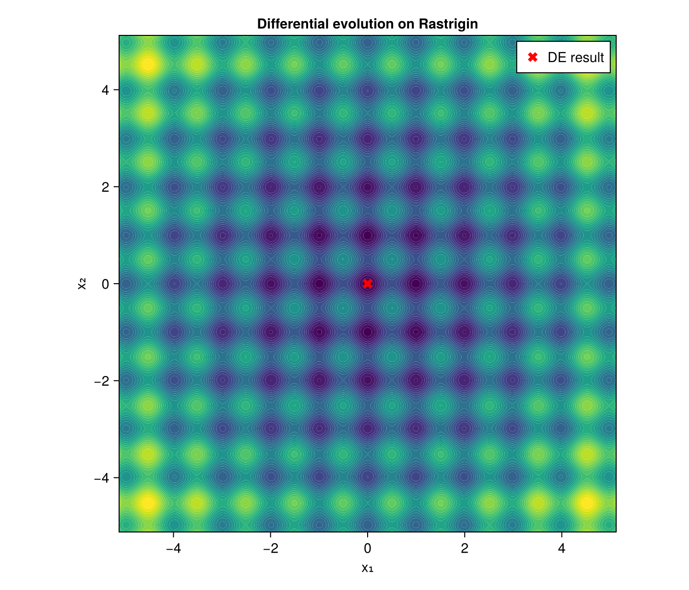

# Minimizers

Global optimisers used in calibrations.

## Differential evolution (`de.jl`)
- `makeDifferentialEvolutionOptimizer(params, problem, rng, strategy)` builds an optimiser over a bounded `Problem`.
- `makeDifferentialEvolutionOptimizerWithElite` keeps elite members across generations.
- Mutation strategies: `Best1Bin`, `Best2Bin`, `Rand1Bin`, `Rand1EitherOr`, `Rand1Exp`.
- `optimize(o, TerminationCriteria(...))` runs it; `minimum`, `minimizer` and `numberOfEvaluations` report the result. Optional quasi-random initialisation (`useQuasiInit`) and a starting point (`x0`) are supported.

## Simulated annealing (`sa.jl`)
- `SimulatedAnnealing(problem, rng)` with `optimize`, `minimum`, `minimizer` and `numberOfEvaluations`. Status is reported with `SAStatusCode`.

Both work on a `Problem` holding the objective and the box bounds.

## Figure



*Differential evolution on the 2D Rastrigin function. The solver reaches the global minimum at the origin (red cross).*

Code that generates the figure (run from the repository root with CairoMakie installed):

```julia
using AQFED, CairoMakie
import AQFED.GlobalOptimization as GO
import AQFED.Random: MersenneTwister64

# Differential evolution on the 2D Rastrigin function (global minimum 0 at the origin)
rastrigin(x) = 20.0 + sum(xi^2 - 10.0 * cos(2π * xi) for xi in x)
problem = GO.Problem(2, rastrigin, [-5.12, -5.12], [5.12, 5.12])
optimizer = GO.makeDifferentialEvolutionOptimizer(GO.OptimizerParams(30), problem,
    MersenneTwister64(UInt64(1234)), GO.Best1Bin(0.9, 0.5))
GO.optimize(optimizer, GO.TerminationCriteria(300, 50, 1e-8, 1e-8))
xBest = GO.minimizer(optimizer)
println("minimum found: ", GO.minimum(optimizer), " at ", xBest)

grid = collect(range(-5.12, 5.12, length=201))
fig = Figure(size=(700, 600))
ax = Axis(fig[1, 1], xlabel="x₁", ylabel="x₂", title="Differential evolution on Rastrigin",
    aspect=DataAspect())
contourf!(ax, grid, grid, [rastrigin([x, y]) for x in grid, y in grid], levels=30, colormap=:viridis)
scatter!(ax, [xBest[1]], [xBest[2]], color=:red, markersize=14, marker=:xcross, label="DE result")
axislegend(ax, position=:rt)
save("resources/images/de_rastrigin.png", fig, px_per_unit=2)
```
