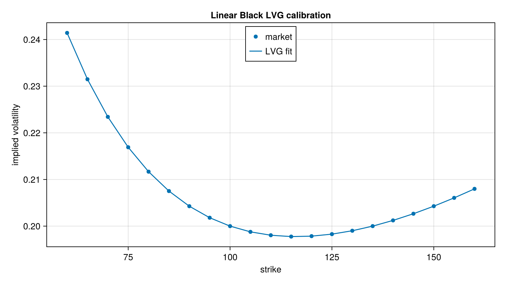

# PDDE: Local Volatility Models

Pricing of European options in local volatility models by solving the forward (Dupire-type) PDE in a one-step (semi-analytic) form, plus the calibration routines built on them.

## Models
- `ConstantLVG`, `ConstantBlackLVG`, `LinearBlackLVG`, `EQuadraticLVG`: local volatility functions that are piecewise constant, linear or quadratic in the state, priced by `priceEuropean` and `derivativePrice`.
- `DiscreteLVG` and `DiscreteLogLVG`: discrete-time versions of the quadratic LVG, with cubic-spline or quadratic-Lagrange price interpolation (`CubicSplinePriceInterpolation`, `QuadraticLagrangePriceInterpolation`).
- `ah.jl`, `ah_bspline.jl`: Andersen-Hagan one-step local volatility, including a B-spline parameterisation.
- `green.jl` (`GreenAH` submodule): Green's function one-step local volatility with Chebyshev discretisation.

## Calibration
- `calibrateConstantLVG`, `calibrateConstantBlackLVG`, `calibrateLinearBlackLVG`, `calibrateEQuadraticLVG`, `calibrateDiscreteLogLVG` fit a model to call prices at one expiry, with weights and bounds `L`/`U`.
- `makeKnots` builds the knot placement used by the quadratic calibrations.
- `GreenAHSurface` and `calibrateGreenAHSurface` calibrate a full surface; `greenDupireLocalVolatility` evaluates the local volatility.

Related: the book chapters on local volatility use these routines. See also the [vol](../vol) module for the forward PDE term-structure calibration.

## Figure



*Linear Black LVG calibrated to a synthetic smile of call prices. The fitted implied volatilities reproduce the market smile.*

Code that generates the figure (run from the repository root with CairoMakie installed):

```julia
using AQFED, CairoMakie
import AQFED.PDDE: calibrateLinearBlackLVG, priceEuropean
import AQFED.Black

# Calibrate a linear Black local volatility model to a synthetic smile and compare implied volatilities
tte = 1.0; forward = 100.0
strikes = collect(60.0:5.0:160.0)
marketVol(k) = 0.2 + 0.1 * (log(k / forward))^2 - 0.03 * log(k / forward)
marketPrices = [Black.blackScholesFormula(true, k, forward, marketVol(k)^2 * tte, 1.0, 1.0) for k in strikes]
lvg = calibrateLinearBlackLVG(tte, forward, strikes, marketPrices, ones(length(strikes)),
    useVol=false, L=strikes[1] / 2, U=strikes[end] * 2)
fitPrices = priceEuropean.(Ref(lvg), true, strikes)
fitVol = [Black.impliedVolatility(true, p, forward, k, tte, 1.0) for (p, k) in zip(fitPrices, strikes)]

fig = Figure(size=(800, 450))
ax = Axis(fig[1, 1], xlabel="strike", ylabel="implied volatility", title="Linear Black LVG calibration")
scatter!(ax, strikes, marketVol.(strikes), label="market")
lines!(ax, strikes, fitVol, label="LVG fit")
axislegend(ax, position=:ct)
save("resources/images/pdde_lvg_fit.png", fig, px_per_unit=2)
```
