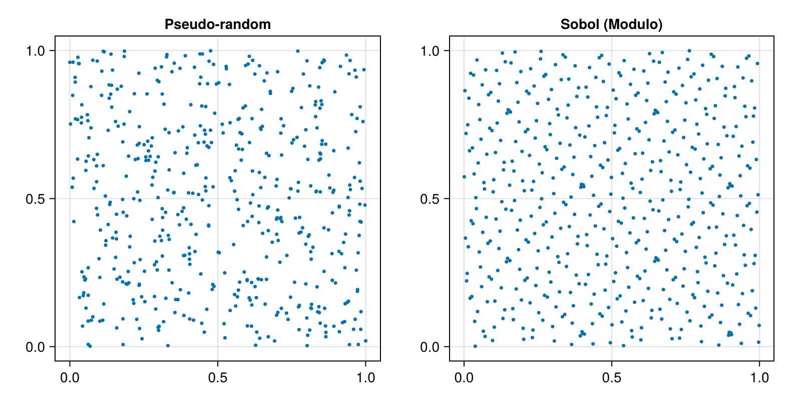

## Random Number Generators
### Pseudo-Random Number Generators

- Blabla
- Chacha
- Mixmax
- MRG63k3a
- Mersenne-Twister 64
- Well1024a

### Quasi-Random Number Generators

- Sobol
- Randomized Sobol
- Scrambled Sobol

## Figure



*512 points of a 2D Sobol (Modulo) sequence (right) against 512 pseudo-random points (left). The Sobol points cover the square more evenly.*

Code that generates the figure (run from the repository root with CairoMakie installed):

```julia
using AQFED, CairoMakie
import AQFED.Random: ModuloSobolSeq, Chacha8SIMD, next!

# First 512 points of a 2D Sobol sequence against 512 pseudo-random points
seq = ModuloSobolSeq(2, 2^14 - 1, Chacha8SIMD(UInt32, 20100921))
points = Vector{Float64}(undef, 2)
sobol = Matrix{Float64}(undef, 512, 2)
for i in 1:512
    next!(seq, points)
    sobol[i, :] = points
end
pseudo = rand(512, 2)

fig = Figure(size=(800, 400))
ax1 = Axis(fig[1, 1], title="Pseudo-random", aspect=DataAspect())
scatter!(ax1, pseudo[:, 1], pseudo[:, 2], markersize=5)
ax2 = Axis(fig[1, 2], title="Sobol (Modulo)", aspect=DataAspect())
scatter!(ax2, sobol[:, 1], sobol[:, 2], markersize=5)
save("resources/images/sobol_points.png", fig, px_per_unit=2)
```
