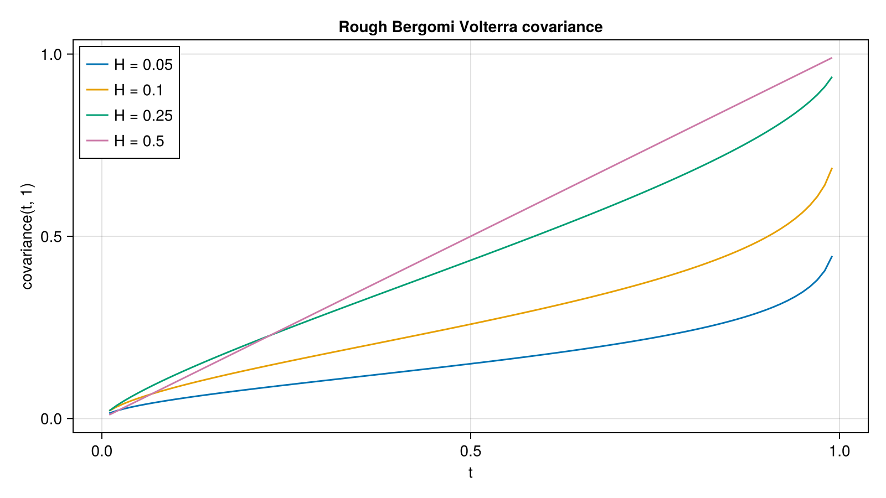

# Rough Volatility

Rough Heston and rough Bergomi-type models: characteristic functions, simulation and roughness estimation.

## Pricing
- `RoughHestonParams` with `PadeCharFunc` and `AdamsCharFunc` characteristic functions. The rough Heston characteristic functions themselves live in CharFuncPricing; this module wraps them for use in AQFED.
- `logForward` gives the log-forward for a rough Heston model.

## Simulation
- `simulateHQE` and `simulateHQEPath`: hybrid quadratic-exponential scheme for rough Heston paths.
- `FlatRoughBergomi` and `FlatRoughExp`: flat-forward-variance rough models, with `covariance`, `instantVariance` and `ndims` for Monte Carlo.
- `AbsoluteBrownianSV`, `ExpOUSV`, `SVCJModel`: other stochastic volatility path generators, used as comparators.
- `IntegralDiscretization` (`LeftRectangular`, `RightRectangular`, `Trapezoidal`) selects how the fractional kernel integral is discretised.

## Roughness estimation (`estimate.jl`)
- `estimateRHanSchied` and `estimateRSHanSchied` estimate the roughness exponent from a volatility series.
- `realizedVolatility`, `parkinsonVolatility`, `realizedVolatilityCum` compute realised measures from price series.

## Figure



*Volterra covariance of the rough Bergomi driver with its value at t = 1, for several Hurst exponents H. The shape changes markedly with H: small H rises steeply near maturity.*

Code that generates the figure (run from the repository root with CairoMakie installed):

```julia
using AQFED, CairoMakie
import AQFED.Rough: FlatRoughBergomi, covariance

# Volterra covariance of the rough Bergomi driver at t and at maturity 1, for several Hurst exponents
times = collect(0.01:0.01:0.99)
fig = Figure(size=(800, 450))
ax = Axis(fig[1, 1], xlabel="t", ylabel="covariance(t, 1)", title="Rough Bergomi Volterra covariance")
for H in (0.05, 0.1, 0.25, 0.5)
    model = FlatRoughBergomi(0.3, H, 1.0, -0.9)
    lines!(ax, times, [covariance(model, t, 1.0) for t in times], label="H = $H")
end
axislegend(ax, position=:lt)
save("resources/images/rough_covariance.png", fig, px_per_unit=2)
```
