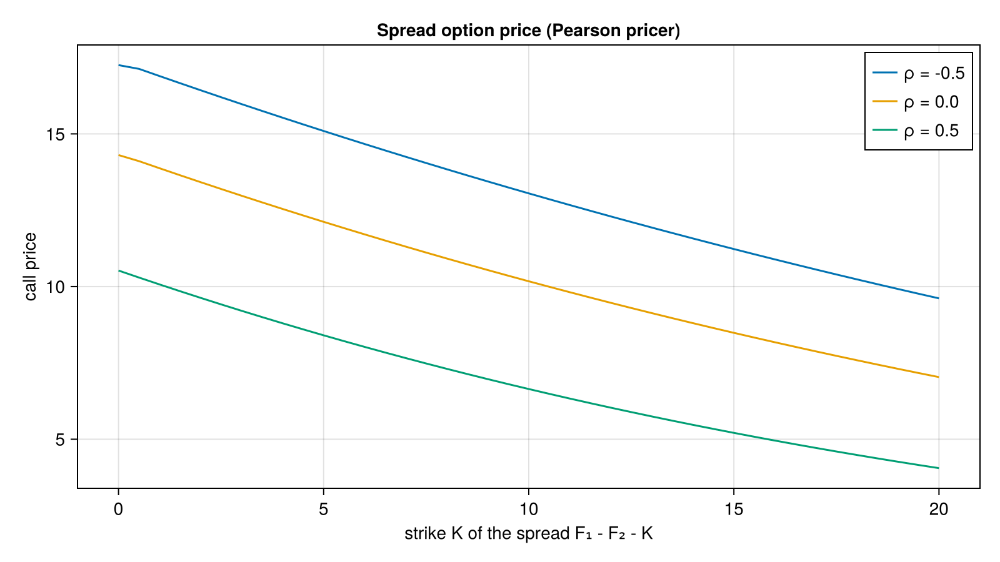

# Spread Options

Pricing of spread options (difference of two underlyings).

## Pricers
- `PearsonPricer`: spread pricer, with `oneStepGridSpread` as its one-step grid calculation. Used through `priceVanillaSpread(pricer, isCall, strike, discountFactor, spot, ...)`.
- `priceAsianSpread` prices Asian-style spread options from forwards and total variances.
- `black_integral.jl` gives numerical integration for spread options under Black-Scholes.
- `margrabe0` is the Margrabe exchange-option formula, the zero-strike case, used as a reference.
- `inner` and `oneStepGridSpread` are the internal building blocks.



*Call price of the spread `F₁ - F₂ - K` for two assets with volatilities 20% and 30%, spot and forward 100, maturity 1 year, for three correlations. Price falls with the strike and rises as correlation falls.*

Code that generates the figure (run from the repository root with CairoMakie installed):

```julia
using AQFED, CairoMakie
import AQFED.Spread

# Call price of the spread F1 - F2 - K for three correlations
pricer = Spread.PearsonPricer(16)
spot = [100.0, 100.0]; fwd = [100.0, 100.0]; tv = [0.2^2, 0.3^2]
Ks = range(0.0, 20.0, length=41)
fig = Figure(size=(800, 450))
ax = Axis(fig[1, 1], xlabel="strike K of the spread F₁ - F₂ - K", ylabel="call price",
    title="Spread option price (Pearson pricer)")
for ρ in (-0.5, 0.0, 0.5)
    prices = [Spread.priceVanillaSpread(pricer, true, K, 1.0, spot, fwd, tv, ρ) for K in Ks]
    lines!(ax, collect(Ks), prices, label="ρ = $ρ")
end
axislegend(ax, position=:rt)
save("resources/images/spread_price_vs_strike.png", fig, px_per_unit=2)
```

Inputs are the two spots, volatilities, correlation `rho`, rates and dividend yields `q1`, `q2`, plus the maturity.
