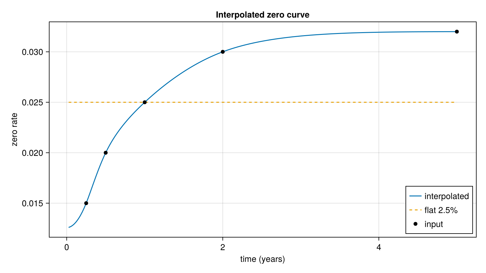

# Term Structures

Discount and drift curves, dividends and a few model term structures used across the pricers.

## Discount curves (`curve.jl`)
- `Curve` (abstract), with `ConstantRateCurve`, `InterpolatedLogDiscountFactorCurve`, `SpreadCurve`, `OppositeCurve` and `PiecewiseConstantFunction`.
- `discountFactor`, `logDiscountFactor`, `forward` and `logForward` are defined for every curve type.

## Dividends (`dividend.jl`)
- `Dividend` and `CapitalizedDividend`, with `futureValue` to capitalise a cash dividend to a given date.
- `DividendDriftCurve` turns a dividend schedule into a drift curve.
- `DiscreteDividendMarket` bundles spot, rates and discrete dividends; `withDividendAmount` and `withGrowthRate` return modified copies, and `forward` gives the forward for a time to expiry.

## Heston term structures (`heston.jl`)
- `HaganHestonPiecewiseParams` and `makeHestonTSParams` / `makeHaganHestonPiecewiseParams` convert between Heston parameters and piecewise-constant term-structure parameters.
- `HestonModel` (single or double Heston) with discount, forward and log-forward functions.

## Other
- `fukasawa_interp.jl`: interpolation utilities.

Example
```julia
using AQFED.TermStructure
c = ConstantRateCurve(0.05)
discountFactor(c, 1.0)
```

## Figure



*Zero rates of a spline through log discount factors (black points are the inputs), against a flat 2.5% curve.*

Code that generates the figure (run from the repository root with CairoMakie installed):

```julia
using AQFED, CairoMakie
import AQFED.TermStructure: InterpolatedLogDiscountFactorCurve, ConstantRateCurve
import PPInterpolation: CubicSplineNatural

# Discount curve interpolated on log discount factors, against a flat rate curve
times = [0.0, 0.25, 0.5, 1.0, 2.0, 5.0]
zeroRates = [0.01, 0.015, 0.02, 0.025, 0.03, 0.032]
curve = InterpolatedLogDiscountFactorCurve(CubicSplineNatural(times, -zeroRates .* times))
flat = ConstantRateCurve(0.025)
t = collect(range(0.0, 5.0, length=201))[2:end]
zeroCurve = [-log(AQFED.TermStructure.discountFactor(curve, x)) / x for x in t]
zeroFlat = [-log(AQFED.TermStructure.discountFactor(flat, x)) / x for x in t]

fig = Figure(size=(800, 450))
ax = Axis(fig[1, 1], xlabel="time (years)", ylabel="zero rate", title="Interpolated zero curve")
lines!(ax, t, zeroCurve, label="interpolated")
lines!(ax, t, zeroFlat, linestyle=:dash, label="flat 2.5%")
scatter!(ax, times[2:end], zeroRates[2:end], color=:black, label="input")
axislegend(ax, position=:rb)
save("resources/images/ts_discount_curve.png", fig, px_per_unit=2)
```
