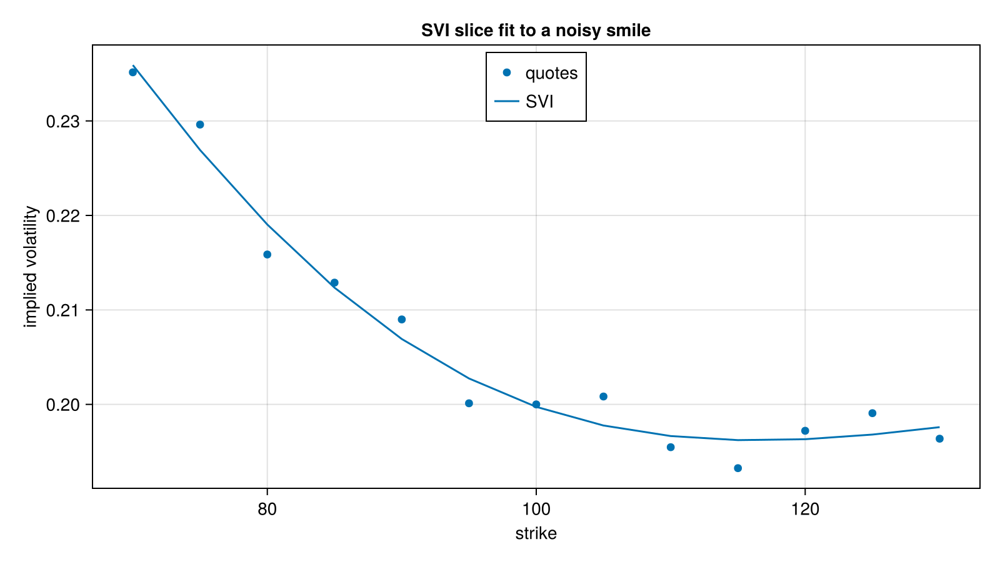

# Volatility Surfaces and Calibration

Smile and surface models fitted to market implied volatilities or option prices.

## Surfaces
- **Fengler** (`fengler.jl`): arbitrage-aware smile surfaces built from `C2Spline` slices. `calibrateFenglerSlice`, `calibrateFenglerSurface` and `calibrateFenglerSurfaceJoint` fit them; `price`, `varianceByLogmoneyness` and `density` evaluate them.
- **Multiquadric RBF** (`cvi2d.jl`, `cvi.jl`): `Multiquadric2DSurface` with `calibrateMultiquadricSurface2D`, giving total variance, its derivatives and the implied density.
- **SVI, SSVI, SABR**: calibrations in `svi_calibration.jl`, `ssvi_calibration.jl` and `sabr_calibration.jl`.
- **Lognormal mixture** (`lnmixture.jl`): fit of a mixture of lognormals to a smile.

## Stochastic models
- `heston_calibration.jl`, `hestonts_calibration.jl`, `heston_hagan.jl`: Heston and term-structure Heston calibration, including the Hagan approximation. `calibrateDoubleHestonFromPrices` handles the double Heston model.
- `varswap.jl`: variance swap pricing and fair-variance utilities.

## American options
- `american_calibration.jl`: calibrates carry and ATM volatilities for American option sections from quotes, via `calibrateAmericanSection`, `calibrateCarryAndATMVols` and `americanImpliedVolatility`.

## Other
- `QuadraticLVForwardPDE` and `calibrateQuadraticLVTermStructure`: quadratic local volatility term-structure fit by forward PDE.

Units: volatilities are decimals (0.2 is 20%) in the APIs.

## Figure



*An SVI slice fitted to a smile with a small deterministic perturbation. The fit captures the shape; the residual is the perturbation.*

Code that generates the figure (run from the repository root with CairoMakie installed):

```julia
using AQFED, CairoMakie
import AQFED.VolatilityModels: calibrateSVISection
import AQFED.TermStructure: varianceByLogmoneyness

# Fit an SVI slice to a noisy synthetic smile
tte = 1.0; forward = 100.0
strikes = collect(70.0:5.0:130.0)
ys = log.(strikes ./ forward)
trueVol(y) = 0.2 + 0.15 * y^2 - 0.05 * y
vols = [trueVol(y) + 0.003 * sin(37.0 * y) for y in ys]
svi, rmse = calibrateSVISection(tte, forward, ys, vols, ones(length(ys)), aMin=-2 * maximum(vols)^2)
fitVol = sqrt.(varianceByLogmoneyness(svi, ys) ./ tte)
println("SVI slice RMSE: ", rmse)

fig = Figure(size=(800, 450))
ax = Axis(fig[1, 1], xlabel="strike", ylabel="implied volatility", title="SVI slice fit to a noisy smile")
scatter!(ax, strikes, vols, label="quotes")
lines!(ax, strikes, fitVol, label="SVI")
axislegend(ax, position=:ct)
save("resources/images/svi_fit.png", fig, px_per_unit=2)
```
